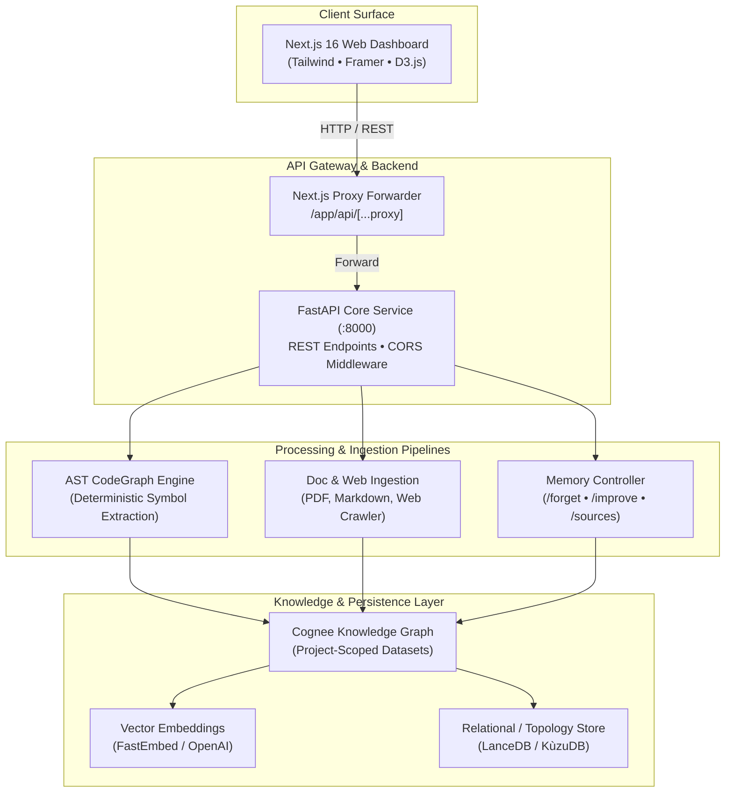
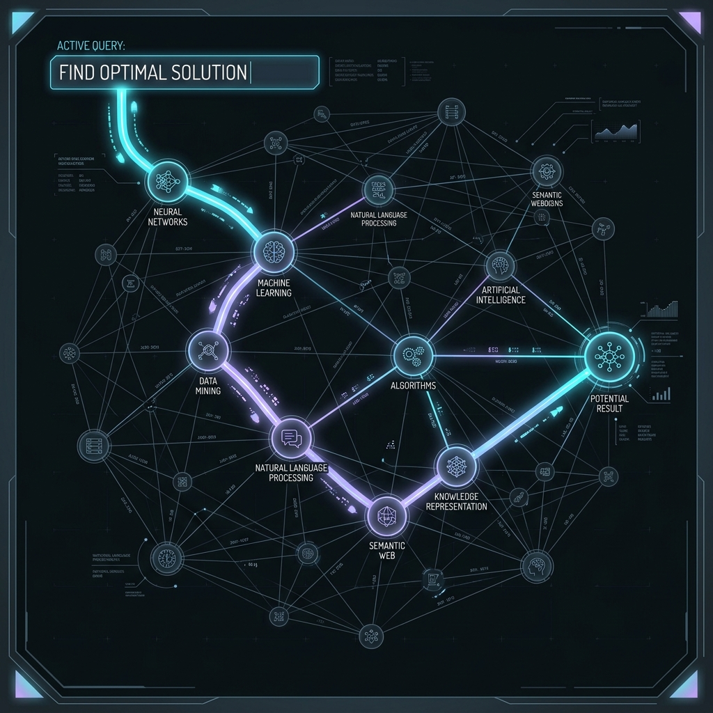
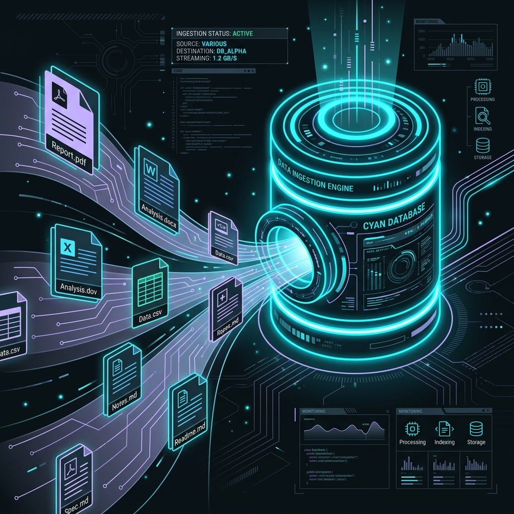
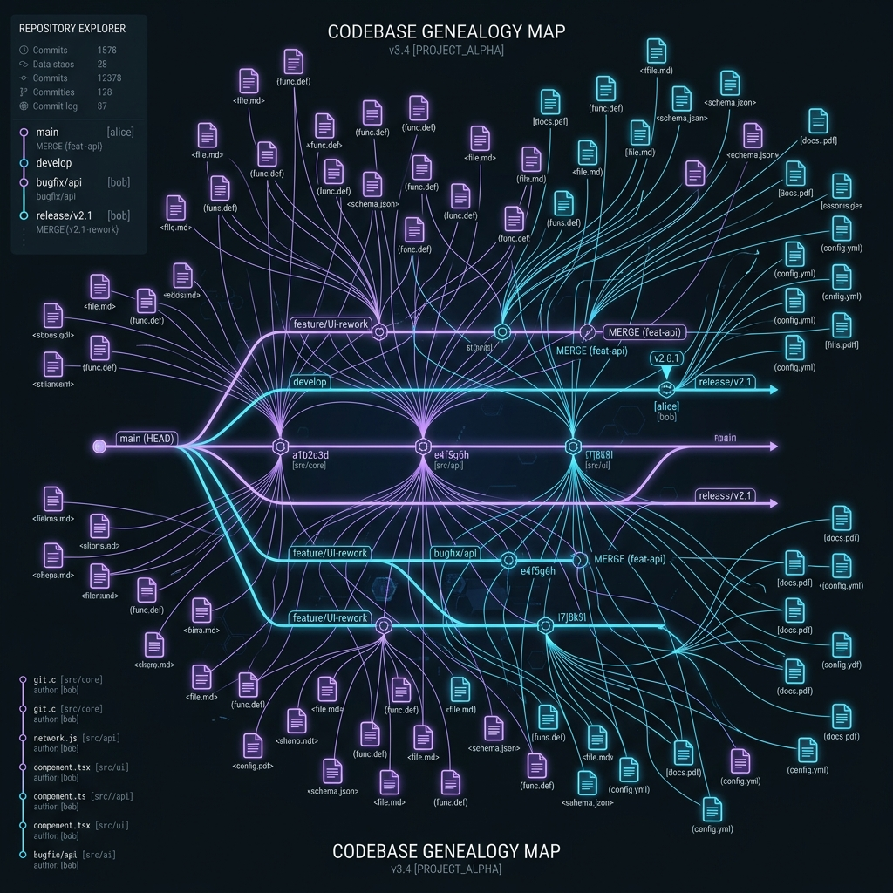

<div align="center">

# 🧠 DevDoc

### *Deterministic AST Code-Graph & Cross-Doc Knowledge Engine for Multi-Modal Developer Assistance*

[](https://nextjs.org)
[](https://fastapi.tiangolo.com)
[](https://www.typescriptlang.org)
[](https://python.org)
[](https://cognee.ai)
[](https://d3js.org)
[](LICENSE)

<br />

<p align="center">
  <strong>DevDoc unifies codebase Abstract Syntax Trees (AST), API specifications, architectural PDFs, and live web wikis into a queryable, topologically aware Knowledge Graph.</strong>
  <br />
  Move beyond flat vector search. Reason across physical call hierarchies, eliminate context rot with active memory pruning, and explore your architecture with an interactive D3 force visualizer.
</p>

[⚡ Overview](#-overview) •
[💡 Why Graph RAG?](#-why-devdoc-graph-rag-vs-naive-vector-rag) •
[✨ Core Capabilities](#-core-capabilities) •
[🏛️ System Architecture](#-system-architecture) •
[🖼️ UI Gallery](#-ui-walkthrough--gallery) •
[🚀 Quick Start](#-quick-start) •
[📡 API Reference](#-backend-api-reference)

---

</div>

## ⚡ Overview

Modern AI coding assistants (e.g., Cursor, GitHub Copilot) excel at localized tab completions, but struggle when reasoning across sprawling codebases, cross-module dependencies, and external documentation. When code is sliced into **arbitrary 500-token text chunks**, physical execution semantics, caller-callee chains, and architectural relationships are permanently lost.

**DevDoc** solves this by generating a **deterministic Abstract Syntax Tree (AST) Knowledge Graph** from your source code and fusing it with external documentation (PDFs, Markdown, Web URLs) inside **Cognee Graph Memory**.

```
Traditional RAG:  Code / Docs  ───> Arbitrary 500-Token Chunks  ───> Flat Vector DB  ───> Blind Keyword Matches
DevDoc Graph RAG: Source AST   ───┐
                  PDFs / Docs  ───┼─> Cognee Knowledge Graph    ───> Topological RAG ───> Multi-Hop Reasoning with
                  Web / Wikis  ───┘   (Classes, Calls, Specs)                             Exact Code Citations
```

### Key Highlights
- **Deterministic AST Code Intelligence**: Maps physical relationships like `(FunctionA)-[:CALLS]->(FunctionB)` and `(Class)-[:IMPLEMENTS]->(Interface)` across 20+ programming languages.
- **Heterogeneous Semantic Fusion**: Explicitly links API definitions in documentation (e.g. PDF user guides, OpenAPI specs) directly to the underlying code symbols.
- **Explainable Topological Retrieval**: Every answer includes clickable file-and-line citations, backed by a real-time D3 force-directed visualizer.
- **Active Memory Hygiene**: Built-in `/forget` and `/improve` endpoints surgically remove obsolete code and reinforce retrieval quality over time.
- **Modern Developer Experience**: Interact through a high-performance, glassmorphic Next.js 16 dashboard with syntax highlighting, live citations, and real-time graph exploration.
- **100% Privacy & Zero Lock-in**: Run completely offline with local Ollama + FastEmbed, or connect cloud LLMs (Groq, Gemini, OpenAI) with zero configuration friction.

---

## 💡 Why DevDoc? (Graph RAG vs. Naive Vector RAG)

| Evaluation Dimension | Traditional Vector RAG (Cursor / Copilot) | DevDoc AST Knowledge Engine |
| :--- | :--- | :--- |
| **Data Scope** | Restricted to active editor buffers and open tabs. | **Unified Heterogeneous Graph:** External docs, PDFs, API specs, and AST syntax trees live in one persistent memory model. |
| **Indexing Method** | **Arbitrary Text Slicing:** Breaks source code into fixed-length text chunks, severing function bodies from callers. | **Deterministic AST Graphing:** Parses code into semantic nodes (`Class`, `Function`, `Import`, `Route`) with verified relational edges. |
| **Cross-Doc Linking** | Weak & ephemeral. Requires manual `@Web` lookups or pasting URLs into chat per prompt. | **Permanent Semantic Linking:** Mentions of endpoints or functions in documentation are natively linked to AST implementation nodes. |
| **Complex Multi-Hop Queries** | ❌ Fails on questions like *"Which controller calls the auth middleware and where is it documented in our security spec?"* | ✅ Traverses multi-hop edges from route controller ➔ service ➔ middleware ➔ linked PDF security section. |
| **Auditability & Explainability** | Black-box retrieval without visible reasoning paths. | **Interactive D3 Visualizer:** Inspect force-directed graph topologies, node centrality metrics, and active traversal paths. |
| **Memory Hygiene** | Ephemeral context window; no mechanism to purge outdated code or refactored functions. | **Active Memory Management:** Built-in `forget` and `improve` APIs surgically purge dead code and calibrate graph recall. |

---

## ✨ Core Capabilities

### 🌳 1. Deterministic AST Code Graph Generation
DevDoc doesn't guess code structure—it parses it. Using an Abstract Syntax Tree (AST) extraction pipeline, DevDoc generates an architectural Directed Acyclic Graph (DAG) structured into clear tiers:
- **Tier 0 • Entry Points**: Application bootstrap, server initialization, CLI triggers.
- **Tier 1 • HTTP Routing**: API route definitions, controller endpoints, request handlers.
- **Tier 2 • Core Business Logic**: Service modules, domain orchestration, business rules.
- **Tier 3 • Parsers & Manifests**: AST symbol extraction, manifest trackers, symbol indexing.
- **Tier 4 • Configuration & State**: Settings, environment variables, database schemas.

### 📄 2. Heterogeneous Multi-Source Ingestion
Feed knowledge into your project from multiple disparate sources simultaneously:
- **Git Repositories & Local Folders**: Ingest local codebases or clone remote GitHub repositories (`https://github.com/...`).
- **Technical Documentation**: Drag-and-drop `.pdf`, `.md`, `.txt`, `.docx`, and `.json` documents.
- **Remote Web Documentation**: Crawl framework documentation, external wikis, or OpenAPI/Swagger URLs.

### 🕸️ 3. Interactive D3.js Force-Directed Graph Visualizer
Inspect your project's knowledge graph with real-time physics simulation:
- **Hub & Satellite Clustering**: AST symbols (functions, methods, classes) visually orbit their parent file hub.
- **Layered Architecture View**: Toggle between a physics-driven force layout and an architectural DAG hierarchy.
- **Deep-Dive Symbol Inspector**: Click any node to inspect its file origin, outgoing/incoming call edges, degree centrality, and associated documentation.

### 🧹 4. Active Memory Pruning & Continuous Self-Improvement
Knowledge bases rot when code refactors happen. DevDoc provides active memory management:
- **`forget` Endpoint**: Surgically delete obsolete endpoints, superseded documentation, or renamed files without rebuilding the entire graph.
- **`improve` Endpoint**: Submit natural-language correction feedback to calibrate subsequent graph retrieval passes.

### 💻 5. High-Density Glassmorphic Web Dashboard
A responsive dark-mode workspace built with Next.js 16, Tailwind CSS, Framer Motion, and D3.js—featuring source-aware chat, citation badges, topology controls, and drag-and-drop ingestion pipelines.

---

## 🏛️ System Architecture

DevDoc is designed as a clean, decoupled monorepo:



---

## 🖼️ UI Walkthrough & Gallery

<div align="center">

### 1. Interactive Force-Directed Knowledge Graph
*Explore your codebase topology, AST symbol clusters, and documentation connections with real-time physics.*



<br />

### 2. Multi-Source Ingestion Studio
*Ingest GitHub repositories, local directories, PDFs, and remote documentation URLs into project-scoped datasets.*



<br />

### 3. Topological AST Code Graph & Symbol Inspector
*Inspect architectural tiers, file hubs, satellite symbols, and caller-callee execution edges.*



</div>

---

## 📁 Repository Structure

```text
devDoc/
├── docs/                                  # Architectural & UI Specifications
│   └── FRONTEND_DESIGN_SPEC.md            # Glassmorphic tokens, CSS system, component blueprint
├── devdoc/                                # Application Source Monorepo
│   ├── backend/                           # FastAPI Service & Cognee Engine
│   │   ├── main.py                        # REST API routes, startup lifespan, CORS
│   │   ├── cognee_service.py              # Cognee SDK wrapper & AST pipeline logic
│   │   ├── graph_routes.py                # D3 graph serializer, inventory & metrics endpoints
│   │   ├── config.py                      # Pydantic environment configuration & defaults
│   │   ├── Dockerfile                     # Container deployment image
│   │   └── requirements.txt               # Backend Python dependencies
│   ├── frontend/                          # Next.js 16 Web Dashboard
│   │   ├── app/                           # App Router (Layout, Providers, API Proxy)
│   │   ├── components/                    # Glassmorphism UI (Chat, Graph, Ingest, Memory)
│   │   ├── hooks/                         # Telemetry & toast notification hooks
│   │   ├── lib/                           # Typed API client, D3 simulation utilities
│   │   └── tailwind.config.ts             # Tailwind CSS tokens & color variables
│   ├── scripts/                           # Setup and Automation Scripts
│   │   ├── devdoc_starter.py              # Interactive verification CLI
│   │   ├── setup_and_run.bat              # One-click Windows launch automation
│   │   └── setup_and_run.sh               # One-click Linux/macOS launch automation
│   ├── tests/                             # Pytest Suite
│   │   ├── test_endpoints.py              # API route verification & health checks
│   │   ├── test_data.py                   # Ingestion test fixtures
│   │   └── test_query.py                  # Knowledge graph query validation
│   ├── Makefile                           # Developer shortcut targets
│   └── setup_all.sh                       # Monorepo dependency installer
├── .env.example                           # Multi-provider environment configuration template
└── README.md                              # Main documentation hub
```

---

## 🚀 Quick Start

### Prerequisites
- **Python:** `3.10` or higher
- **Node.js:** `18.x` or higher (with `npm`)
- **Git**

---

### Step 1: Clone and Configure Environment

```bash
git clone https://github.com/Saumojit30/DevDoc.git
cd DevDoc

# Create your environment configuration file
cp .env.example .env
```

Open `.env` and select your preferred LLM provider. DevDoc includes pre-built templates for all major setups:

#### Option A: Groq (Recommended Free Cloud Tier — Ultra Fast)
```ini
LLM_PROVIDER="groq"
LLM_MODEL="llama-3.1-8b-instant"
LLM_ENDPOINT="https://api.groq.com/openai/v1"
LLM_API_KEY="gsk_your_groq_key"
```

#### Option B: Local Ollama (100% Free, Offline & Private)
```ini
LLM_PROVIDER="ollama"
LLM_MODEL="qwen2.5-coder:7b"
LLM_ENDPOINT="http://localhost:11434/v1"
LLM_API_KEY=""
```

#### Option C: Google Gemini (AI Studio or Vertex AI)
```ini
LLM_PROVIDER="gemini"
LLM_MODEL="gemini-2.5-flash"
LLM_API_KEY="AIzaSy_your_gemini_key"
```

#### Option D: OpenAI
```ini
LLM_PROVIDER="openai"
LLM_MODEL="gpt-4o-mini"
LLM_API_KEY="sk-your-openai-key"
```

> [!NOTE]
> By default, DevDoc uses **FastEmbed** (`sentence-transformers/all-MiniLM-L6-v2`) for embeddings, which runs 100% locally and free on your CPU.

---

### Step 2: One-Click Automated Launch

#### Windows (PowerShell)
```powershell
cd devdoc
.\scripts\setup_and_run.bat
```

#### Linux / macOS (Bash)
```bash
cd devdoc
chmod +x scripts/setup_and_run.sh
./scripts/setup_and_run.sh
```

---

### Step 3: Manual Component Startup (Optional)

If you prefer running services in separate terminal windows:

#### Terminal 1 — Backend Core (FastAPI)
```bash
cd devdoc/backend
python -m venv .venv

# Windows:
.\.venv\Scripts\Activate.ps1
# Linux/macOS:
# source .venv/bin/activate

pip install -r requirements.txt
uvicorn main:app --reload --host 0.0.0.0 --port 8000
```
> *Swagger interactive API docs will be available at `http://localhost:8000/docs`.*

#### Terminal 2 — Frontend Dashboard (Next.js 16)
```bash
cd devdoc/frontend
npm install
npm run dev
```
> *Web application will be accessible at `http://localhost:3000`.*

---

## 📡 Backend API Reference

All endpoints accept and return JSON unless otherwise noted.

| Category | Method | Endpoint | Request Body | Description |
| :--- | :--- | :--- | :--- | :--- |
| **System** | `GET` | `/health` | — | Health check, Cognee service liveness, and version. |
| **Chat & Q&A** | `POST` | `/api/chat` | `{ project, question, onlyContext?, sessionId? }` | Queries the knowledge graph and returns citation-backed answers. |
| **Ingestion** | `POST` | `/api/ingest/docs` | `FormData(project, urls?, files?)` | Ingests uploaded documents (`.pdf`, `.md`, `.txt`) and web URLs. |
| **Ingestion** | `POST` | `/api/ingest/code` | `{ project, repoPath, cloneUrl?, sessionId? }` | Ingests a local codebase directory or clones a Git repo into the AST graph. |
| **Memory** | `POST` | `/api/memory/forget` | `{ project, source, sessionId? }` | Surgically removes a file, URL, or code node from project memory. |
| **Memory** | `POST` | `/api/memory/improve` | `{ project, feedback?, sessionIds }` | Refines and reinforces graph retrieval using feedback notes. |
| **Memory** | `POST` | `/api/memory/sources` | `{ project }` | Returns a list of all active ingested sources for a project. |
| **Topology** | `POST` | `/api/graph/data` | `{ project }` | Returns node and edge collections formatted for D3 force rendering. |
| **Topology** | `POST` | `/api/graph/metrics` | `{ project }` | Computes graph metrics (node count, edge count, density). |
| **Topology** | `POST` | `/api/graph/inventory` | `{ project, samples_per_type? }` | Returns a categorized inventory of graph entity nodes. |

---

## 🧪 Testing & Verification

DevDoc includes end-to-end integration tests to validate endpoints, data ingestion, and graph query generation:

```bash
cd devdoc

# Run test suites with pytest
pytest tests/ -v
```

To run an interactive verification cycle via the CLI starter tool:
```bash
python scripts/devdoc_starter.py
```

---

## 🗺️ Roadmap & Vision

- [x] Deterministic AST parsing for 20+ languages (Python, TypeScript, JavaScript, Go, Rust, Java, C/C++)
- [x] Heterogeneous multi-source ingestion (PDFs, Markdown, Web URLs, Git repositories)
- [x] D3.js interactive force-directed visualizer with layered architecture DAG view
- [x] Active memory pruning (`/forget`) and reinforcement calibration (`/improve`)
- [x] High-performance glassmorphic Next.js 16 web dashboard
- [x] Multi-LLM provider support (Groq, Local Ollama, Gemini, OpenAI)
- [ ] Language Server Protocol (LSP) AST integration for real-time symbol tracking
- [ ] Multi-tenant enterprise team synchronization via Neo4j / Memgraph connectors
- [ ] GitHub Actions CI/CD bot for automated pull-request documentation diff ingestion

---

## 📄 License

This project is licensed under the [MIT License](LICENSE).

<div align="center">
  <sub>Built with ❤️ for developers who build deep, ambitious software systems.</sub>
</div>
